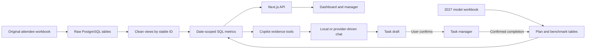

# Deccan Drift Growth Center

A local operating dashboard for the Deccan Drift Pune 2027 attendee-growth strategy. The historical workspace reconstructs CampusFest 2025 from the original attendee workbook. The Plan screen imports the 2027 proposals and their assumptions separately.

- **Live deployment:** [deccan-drift-growth-center.vercel.app](https://deccan-drift-growth-center.vercel.app), running on Vercel with a Neon PostgreSQL database and the OpenAI copilot. See [Hosted deployment](#hosted-deployment).
- **Local:** open the running app at [127.0.0.1:3000](http://127.0.0.1:3000) after following [Run locally](#run-locally).

## Run locally

Use Node.js 22.9 or later, npm, Python 3.10 or later, and PostgreSQL 16 with its client utilities. The workbook reader uses the Python standard library. On Windows the launcher detects PostgreSQL 16 in Program Files. Elsewhere, put the PostgreSQL binaries on PATH or set `PG_BIN` to the directory containing `postgres`, `initdb` and `psql`. Set `PYTHON` if your interpreter is called `python3`.

From the project directory, with the supplied workbooks at its root, run the following commands. The current workspace already contains installed dependencies.

```powershell
npm.cmd ci --legacy-peer-deps
npm.cmd run seed
npm.cmd run dev
```

For a local production preview, run `npm.cmd run build` followed by `npm.cmd start`. Set `PORT` before starting to select another port. The default listener is loopback. The launcher creates a private PostgreSQL cluster under `.growth-pg`, with a generated local password in `.local`, and the `growth_center` database. It seeds first use automatically. Those directories and environment files are excluded from version control. The local PostgreSQL port defaults to 55437 and can be configured with `GROWTH_PG_PORT`. To stop the database after stopping the web server, use `pg_ctl -D .growth-pg stop` from the project directory.

### Chatbot API key

The dashboard, edits, simulator, evidence-backed local questions and task drafts work immediately. Open-ended model-driven interpretation and SQL tool selection require one provider key.

1. Open `.env.local` in the project directory. On a fresh checkout, create it from `.env.example`.
2. For OpenAI, set `COPILOT_PROVIDER=openai` and enter your project key after `OPENAI_API_KEY=`. The Responses API adapter defaults to `gpt-4.1-mini`. You can set `OPENAI_MODEL` to another function-calling model available to your project. For Gemini or Anthropic, select the corresponding provider and key in the template. [OpenAI API keys](https://platform.openai.com/api-keys)
3. Restart the web server. The chat panel displays the configured provider. Provider errors appear in the panel, with the question retained for retry.

Keys are read on the server. The mode under each answer records how that turn ran. Local mode uses the same database tools and recognizes common analysis and task requests. Restart the server after editing its provider settings, then start a new chat to check the mode. [Gemini API keys](https://aistudio.google.com/apikey) · [Anthropic Console](https://console.anthropic.com/)

### Seed, reset and verification

```powershell
npm.cmd run seed
npm.cmd test
npm.cmd run eval:copilot
npm.cmd run build
npm.cmd run test:browser
```

`npm.cmd run reset` restores both workbooks and clears local tasks, settings, drafts and conversations. The same action is available under **Data editor → Reset to original**. Re-import and reset are transactional. The audit log survives reset and records who requested it.

The metric tests and original evaluations reset the local `growth_test` database. Run those commands sequentially. The supplied question bank uses `growth_bank_test` and the browser suite uses `growth_browser_test`. The browser suite starts a local preview on port 3149 and uses Chrome. Set `CHROME_PATH` for a different Chromium executable or `GROWTH_BROWSER_PORT` to change the port. The copilot evaluations record the provider mode.

### Challenge questions for reviewers

The copilot evaluation now runs the 23 original checks and 27 additional scenarios. The reviewers' sheet contains the exact questions and follow-ups without the expected answers. Open a fresh chat for each scenario. [Reviewer questions](eval/reviewer-questions.md)

| Command | Evaluation |
|---|---|
| `npm.cmd run eval:copilot` | Original checks followed by challenge scenarios using the configured provider |
| `npm.cmd run eval:challenges` | Challenge scenarios alone using the configured provider |
| `npm.cmd run eval:challenges -- --local` | The same scenarios in local query mode, without API traffic |
| `npm.cmd run eval:question-bank` | Run the supplied A–K question bank using the configured provider and save the transcript for review |
| `npm.cmd run eval:question-bank -- --local` | Run the same bank in local query mode, including isolated task and changed-data scenarios |

The cases cover outside sources, missing measurements, user-supplied assumptions, counting across days and task side effects. For example, a live USD conversion requires an exchange rate. In a separate chat, the reviewer supplies ₹80/USD, making the conditional conversion answerable. A mixed question about competitor CPA earns credit when the reply gives the internal CPA and explains what is missing for the comparison.

The suite checks the displayed answer, conversation scope and changes to drafts and audited records. Each mode gets its own transcript in `eval/challenge-results-<mode>.md`. The runner returns a nonzero status for unmet checks or execution errors. API connection failures are reported separately. Wording checks are approximate. Use the prompts, expected answers and transcripts to review disputed grades.

The recorded live OpenAI baseline passed 8/27 challenge scenarios. One reply correctly reported ₹134 blended CPA but omitted the missing competitor benchmark. The updated local run passed 23/23 original checks and 13/27 challenges. The supplied bank uses separate conversations, fixtures and review criteria. [Local challenge transcripts](eval/challenge-results-local.md) · [Live OpenAI baseline](eval/challenge-results-openai.md) · [Supplied bank assessment](eval/question-bank-review.md)

## Hosted deployment

The app is deployed at [deccan-drift-growth-center.vercel.app](https://deccan-drift-growth-center.vercel.app). The Vercel project is connected to this GitHub repository, so every push to `main` deploys to production. The database is a Neon PostgreSQL instance provisioned through the Vercel Marketplace.

The live site has no login. Anyone with the URL can edit or reset the data and send copilot questions that use the configured OpenAI key. Enable Vercel deployment protection, or add authentication, before sharing it widely.

### How hosted mode differs from local mode

Vercel functions have no `psql`, `initdb` or Python, so the same code switches behaviour when it runs there.

| Concern | Local | Hosted (Vercel) |
|---|---|---|
| Database access | `psql` against the private cluster in `.growth-pg` | The `pg` Node driver, enabled when `DATABASE_URL` is set and `VERCEL` (or `GROWTH_DRIVER=pg`) is present. It reproduces `psql -qAt` output, so query results are identical. [Database layer](lib/db.mjs) |
| Connection | One `psql` session per query | `DATABASE_URL_UNPOOLED` when available. Evidence queries create temporary tables in one transaction and read them in the next, which a transaction-mode pooler can route to different sessions. Temporary objects are discarded after each call. |
| Seed and reset | `scripts/extract.py` reads the workbooks | Falls back to the pre-extracted [sql/seed-data.sql](sql/seed-data.sql), and converts its `COPY` blocks to batched `INSERT`s. **Data editor → Reset to original** therefore works on Vercel. [Seed script](scripts/seed.mjs) |
| Read-only role | Created by the local superuser | The seed also grants `growth_reader` to the database owner `WITH SET TRUE`. On PostgreSQL 16+, a CREATEROLE owner such as Neon's otherwise cannot `SET ROLE` to it. [Operations](sql/operations.sql) |

`next.config.mjs` includes `sql/` and the workbooks in the API function bundle, because they are read from disk at runtime. `.npmrc` sets `legacy-peer-deps=true`, so Vercel installs dependencies the same way as `npm ci --legacy-peer-deps`.

After changing either workbook, regenerate the snapshot and commit it:

```powershell
python scripts/extract.py > sql/seed-data.sql
```

### Deploying your own copy

Use the Vercel CLI (`npm.cmd i -g vercel`) from the project directory.

```powershell
vercel.cmd link
vercel.cmd integration add neon            # provisions Postgres and sets DATABASE_URL*
vercel.cmd env add COPILOT_PROVIDER production
vercel.cmd env add OPENAI_API_KEY production
vercel.cmd env add OPENAI_MODEL production
vercel.cmd env pull .env.vercel --environment production
```

Seed the hosted database once from your machine, using the unpooled URL from `.env.vercel`. The file is ignored by git, but it contains credentials.

```powershell
$env:GROWTH_DRIVER = "pg"
$env:DATABASE_URL = "<DATABASE_URL_UNPOOLED value from .env.vercel>"
npm.cmd run seed
Remove-Item Env:GROWTH_DRIVER, Env:DATABASE_URL
```

Then deploy with `vercel.cmd deploy --prod`, or push to the connected branch. Re-seed only when the SQL in `sql/` or the workbook snapshot changes. Application-only changes need a deploy alone.

## Product walkthrough

| Screen | What the team can do |
|---|---|
| Overview | Review target attainment, pace and projections. Switch the chart between the season and recent weeks. Rank campaigns by attendance or cost per attendee and inspect the last seven days. |
| Funnel | Compare sessions, people, registrations, confirmations and verified visitors by campaign. Inspect the walk-in row and latest status mix. |
| Campaigns | Compare spend and visitor shares, cost, conversion and weekly registrations. Click a decision badge for its rule and two weekly observations. Choose a channel and comparison period to inspect registration drivers. |
| Budget | Compare cumulative net spend with the effective budget. Move spend between two campaigns and compare linear and diminishing-return estimates. |
| Task manager | Manage campaigns, allocations and tasks. Switch between board and table, filter owners and overdue work, and apply an optional campaign change when completing a task. Historical campaigns with linked records can be stopped. Deletion is available for unused campaigns. |
| Win-back | Filter cancelled and waitlisted people, export CSV, and draft a follow-up task. People with a recorded opt-out are marked and excluded from the outreach action. |
| 2027 plan | Inspect and edit channel scenarios, release gates, comparison thresholds and the registration pace curve. The historical campaign settings are also visible here. |
| Data editor | Filter, add, edit or delete raw rows, append CSV using source headers, bulk-delete a bounded filtered set, download the original attendee workbook and inspect before/after audit entries. |

The current-user selector is stored in a cookie. Historical metrics use the selected end-of-day snapshot. Team assignments and management settings describe the current operating workspace. Every page exposes the date, attribution mode and copilot.

### Demo workflow

The local recording follows a diagnosis through a recommendation, confirmed task and updated overview. Regenerate it with `npm.cmd run test:browser -- --record` on a machine with Playwright's FFmpeg installed. [Watch the recorded workflow](demo/growth-center.webm)

1. Select **20 Apr 2025**, registration attribution, then open **Growth Copilot**.
2. Ask “Which campaigns are underperforming and why?” and “What should we do?” Expand **Data used** for the tool calls and calculations.
3. Ask “Create a task for Arjun to cut Creator Partners spend by Friday.” Review the resolved calendar date, campaign, owner and proposed status change. Choose **Confirm**.
4. Open **Task manager**. The saved AI task links to Creator Partners, source ID **C03**, and the conversation. The open-action count increases. Mark it done and confirm the proposed change. The campaign becomes paused in the directory, Budget and Plan. Historical spend remains the amount actually posted.
5. To test changed data, open **Data editor**, choose Check-ins, filter `campaign_id` by `C02`, set the delete limit to 50 and confirm. Re-open Overview or ask the diagnosis question again. Reset to restore the evidence pack.

## Data and architecture



- The import preserves duplicate rows, column names, stable IDs and the field dictionary. It reads the model workbook's cached numeric results at full precision. Recalculate and save a modified model workbook in a spreadsheet editor before re-importing. [Workbook reader](scripts/extract.py)
- The workspace uses PostgreSQL 16 locally. The hosted deployment uses Neon PostgreSQL through the `pg` driver. Next.js 16.2.12 App Router, TypeScript 5.9.3 and React 19.2.4 serve the product. Recharts 3.10.0 draws the charts. Tailwind CSS 4.1.18, custom CSS, Lucide icons and Radix Dialog underpin the interface. The implementation uses a custom interface, workbook reader, SQL metrics, management endpoints and provider adapters. Codex assisted with implementation and verification. [Package versions](package.json)
- All changes go through server routes. PostgreSQL computes the analytical metrics at query time. Dashboard sections and copilot tools query the same definitions. Management writes and their audit entries commit together. Client reads are refreshed after each write. [Metric definitions](sql/metrics.sql) · [Operations and triggers](sql/operations.sql) · [Evidence tools](lib/evidence.mjs)
- The production deployment runs on Vercel Functions (Node.js) with a free-plan Neon database. The database seed requires permission to create its schemas and the restricted reader role. See [Hosted deployment](#hosted-deployment).

## Cleaning and metric definitions

| Measure or rule | Definition |
|---|---|
| Record identity | Preserve all raw rows. Count each stable ID once in the clean view. If the same ID is re-imported with a correction, the most recently imported copy wins. Repeated names and distinct admission events remain separate. |
| Snapshot time | Interpret Excel serial timestamps in Asia/Kolkata. Store instants as `timestamptz` and marketing posting dates as `date`. Using the next local midnight as an exclusive upper bound includes fractional seconds. |
| Identified people | Distinct external people first seen by the cutoff. Internal, staff and test records are excluded from the growth funnel. |
| Registrations and status | Count external registration IDs by registration time. Select each registration's latest eligible full-state history row. Resolve equal timestamps deterministically by history ID. |
| Attendance | Count distinct external people with an admitted, verified check-in by the cutoff. Entry counts include re-entry. The final 3,250 entries represent 2,050 people, including 125 walk-ins. |
| Attribution | Registration campaign is the default. First-touch uses the person's first campaign. Unregistered identified people use their first campaign when available. Anonymous activity and costs stay with the campaign that posted them. |
| Spend and reach | Sum net posted debits and credits after deduplication. Sessions, impressions, platform reach and email events are activity measures. Unique audience reach across platforms is unavailable. |
| Conversion and cost | Session conversion = registrations / sessions. Campaign show-up = registered attendees / registrations. Blended show-up excludes walk-ins. CPR = net spend / registrations. CPA = net spend / verified attendees. Undefined denominators display a dash. |
| Goals | Use the latest effective target at the cutoff. Attainment = actual / goal. Budget use = spend / approved budget. The source supplies no separate confirmed-registration goal. |
| Pace | Linearly interpolate the editable cumulative pace curve. Pacing = registrations / (registration goal × expected share). Projected registrations = registrations / expected share. A zero expected share yields an undefined forecast. |
| Forecast | Before event close, sum each campaign's projected registrations × editable expected show-up, then add assumed walk-ins. Missing show-up assumptions for active registration volume yield an unavailable forecast. At event close, use observed attendance. |
| Alerts | Default CPR baseline = active approved budget / registration goal. A campaign override takes precedence. CPA baseline = planned CPR / expected show-up. SCALE uses the cumulative ratio ≤ 0.8× baseline. STOP requires two consecutive completed Monday–Sunday campaign weeks above 1.5×. Zero-volume weeks have undefined unit cost. Other measurable campaigns show CHANGE. Multipliers are editable. After the event the weekly comparison ends at the last completed festival week. |
| Drivers | Sequentially substitute spend, sessions per rupee and registrations per session from the later period. Effects add to the registration change before rounding. The allocation depends on substitution order. Zero or negative spend, or zero sessions, makes the decomposition undefined. |
| Simulator | The linear method uses the observed CPAs. The curved method solves `new spend / old spend = m × (1 + k × (m − 1))` and multiplies the volume change by observed show-up. The requested simulator uses this smooth curve for withdrawals as well as additions. It is an assumption for a transfer below baseline. The workbook caps its forward-plan surcharge below 1×. |

## Historical verification

**23 of 23 metric tests passed.** The answer-key suite runs against PostgreSQL after initial import and again after reset. Each row below matched for people, registrations, the **entire** status mix, net spend, attendees and effective target version.

| Snapshot | Identified | Registered | Confirmed | Cancelled | Waitlisted | Interested | Net spend | Attended | Target |
|---|---:|---:|---:|---:|---:|---:|---:|---:|---|
| 15 Feb | 1,055 | 587 | 426 | 30 | 16 | 115 | ₹73,475 | 0 | Launch |
| 1 Mar | 1,658 | 1,144 | 935 | 78 | 36 | 95 | ₹1,35,350 | 0 | Launch |
| 14 Mar | 2,329 | 1,506 | 1,255 | 106 | 48 | 97 | ₹1,89,575 | 0 | Launch |
| 15 Mar | 2,393 | 1,562 | 1,279 | 107 | 48 | 128 | ₹1,89,575 | 0 | Revised |
| 11 Apr | 3,500 | 2,800 | 2,500 | 183 | 88 | 29 | ₹2,76,500 | 0 | Revised |
| 20 Apr | 3,625 | 2,800 | 2,500 | 183 | 88 | 29 | ₹2,74,000 | 2,050 | Revised |

The suite also checks all seven campaign benchmarks, landing sessions, show-up and rounded costs, owner totals, peak registration week, engagement types, day counts, admission sources, return visitors, retry counts and net credits. The simulator's ₹20,000 Paid Social → Student Referrals case gives a linear net gain of about 216 attendees and a diminishing-return gain of about 120. [Answer-key tests](tests/metrics.test.mjs)

**Copilot evaluation** covers the handoff questions, follow-up memory, two-step task execution, duplicate confirmation, proposed changes, guarded SQL, missing fields and two changed-data retests. Deleting the first 50 matching Paid Social raw check-ins changes that campaign from 340 to 312 unique visitors and its CPA from ₹273.53 to ₹298.08. Its diagnosis updates, while Student Referrals still ranks cheapest. Increasing referral spend then changes the cheapest campaign to Organic Search. The full table records expected answers, actual answers, pass/fail, executed provider mode and pass rate. [Evaluation results](eval/results.md)

**Browser verification** covers all eight screens, date and attribution changes, the draft-confirm-complete workflow, campaign updates, filtered deletion, reset and phone navigation. The tests use a separate test database. [Chrome verification](scripts/browser.mjs)

<details>
<summary>Copilot evaluation results by question</summary>

<!-- copilot-results -->

Provider mode: **local**. Database: isolated test database, restored from both original workbooks.

**23 / 23 passed (100%).**

| Question or workflow | Expected | Observed | Result |
|---|---|---|---|
| How many unique people attended? | 2,050 distinct attendees | [Data] 2,050 unique verified external attendees, including 125 unattributed walk-ins. | Pass |
| Which campaign has the lowest cost per attendee? | Student Referrals ₹69 | [Calculation] Student Referrals leads this comparison at ₹69 cost per attendee. Organic Search ₹72 · College Partnerships ₹81 · Community Groups ₹97 | Pass |
| Which campaigns are underperforming and why? | Paid Social and Creator Partners; ~55% of spend, ~27% of attributed visitors, 50% show-up | [Calculation] Creator Partners and Paid Social account for 55.5% of spend and 26.8% of attributed attendees. Their combined registration → attendance rate is 50%. [Data] Creator Partners recorded 4,066 anonymous sessions, 490 identified people, 350 registrations, 290 confirmed and 175 attendees. Session → registration 8.6%. | Pass |
| What should we do? | Recommendation supported by a simulator estimate | [Assumption / estimate] Review new spend on Creator Partners first. Pilot a transfer to Student Referrals. Test a reminder or refundable deposit on Paid Social and measure whether any show-up gain offsets lost registrations. Consider College Partnerships as a second destination at ₹81 per attendee. Recheck marginal acquisition cost and show-up before scaling. [Calculation] Creator Partners leads this comparison at ₹337 cost per attendee. Paid Social ₹274 · Campus Ambassadors ₹108 · Community Groups ₹97 [Calculation] Student Referrals leads this comparison at ₹69 cost per attendee. Organic Search ₹72 · College Partnerships ₹81 · Community Groups ₹97 [Assumption / estimate] Moving ₹20,000 gives a linear net change of 216 attendees. With diminishing returns, the net is 120 attendees. Student Referrals 233 registrations / 183 attendees (linear 289 attendees) · Paid Social -126 registrations  | Pass |
| How many registrations did we have on 1 March? | 1,144 · launch | [Data] 1,144 external registrations. Attendee launch plan | Pass |
| And how does that compare to target? | 1,144 / 2,800 · 40.9% attainment · 102% pacing | [Calculation] 1,144 registrations against the 2,800 full-season goal (40.9%). Pacing is 102.1% of the expected 40% share. Registration shortfall: 1,656. 0 verified attendees against the 1,800 attendance goal (0%), 1,800 short. 1,658 identified people against 3,200 (51.8%). Remaining approved budget: ₹1,04,650. | Pass |
| What was spend as of 11 April vs final, and why are they different? | ₹2,76,500 vs ₹2,74,000 and posted credits | [Data] ₹2,76,500 on 11 Apr 2025 and ₹2,74,000 on 20 Apr 2025. Posted credits in the interval: ₹-2,000 on 16 Apr 2025, ₹-500 on 18 Apr 2025. | Pass |
| How many people came both days? | 725 | [Data] 3,250 admitted entries include re-entries. 2,050 distinct visitors attended, 1,325 on exactly one day and 725 on both days. 725 people re-entered, accounting for 1,200 additional entries. Average entries per visitor: 1.59. 2025-04-12 · 1,430 people, 1,430 first-time visitors; 2025-04-13 · 1,345 people, 620 first-time visitors. | Pass |
| If we move ₹20k from Paid Social to Referrals, what happens? | Linear loss ~73 and gain ~290; diminishing net ~120 | [Assumption / estimate] Moving ₹20,000 gives a linear net change of 216 attendees. With diminishing returns, the net is 120 attendees. Student Referrals 233 registrations / 183 attendees (linear 289 attendees) · Paid Social -126 registrations / -63 attendees (linear -73 attendees). Assumes unchanged show-up, the measured unit costs and editable saturation factors. | Pass |
| Create a task for Arjun to cut Creator Partners spend by Friday | Preview only · C03 · Arjun Verma · resolved Friday | Cut Creator Partners spend · C03 · 2026-12-04 | Pass |
| Confirm twice and complete the proposed change | One AI task, open count 1; completion applies paused status | One linked AI task, one open action, completion applied paused status | Pass |
| Which artist drove the most attendance? | Explains missing field or uncertain forecast | [Not in data] The data can't answer this. There is no artist lineup or link between performances and individual admissions. Attendance by campaign, day or hour is available. | Pass |
| What is the gender split? | Explains missing field or uncertain forecast | [Not in data] The data can't answer this. Age and gender are absent from person records. Attendance can be grouped by acquisition campaign or first-touch source. | Pass |
| How many will attend next year? | Explains missing field or uncertain forecast | [Not in data] The data can't answer this. Future attendance is a forecast. The 2027 plan and its assumptions can provide a range. [Assumption / estimate] 2027 committed plan: 6,196 attendees (about 6,200). Stretch: 10,332. Gate 1 (pace) · Registrations >= 90% of this (35% of committed plan) · 2,589 × 0.9 Gate 2 (pace) · Registrations >= 95% of this (50% of committed plan) · 3,699 × 0.95 Holdback · Share of released funds moved to the best channel · 0 × 1 Sponsor gate (stretch) · Release sponsor-funded stretch money only if blended cost/attendee stays below · 175 × 1 Timed-entry slots · Switch on afternoon/evening entry waves if projected attendees pass · 9,000 × 1 | Pass |
| Which owner drove the most registrations? | Meera Iyer, 970 | [Data] 2,800 cumulative external registrations. Meera Iyer · 970 Arjun Verma · 930 Nisha Rao · 550 Dev Malhotra · 350 | Pass |
| Busiest registration week? | 24 March 2025, 354 | [Data] 2,800 cumulative external registrations. 2025-03-24 · 354 2025-03-31 · 346 2025-03-17 · 324 2025-02-17 · 300 2025-02-10 · 279 2025-03-10 · 258 2025-02-24 · 249 2025-02-03 · 200 | Pass |
| How many people opted out? | 229 | [Data] opted_out · 229 events / 229 people | Pass |
| Scanner vs manual check-ins? | 2,945 scanner, 305 manual | [Data] manual 305 · scanner 2,945 admitted, verified entries. | Pass |
| What's Organic Search's session-to-registration rate? | 250 / 1,893 = 13.2% | [Data] Organic Search recorded 1,893 anonymous sessions, 290 identified people, 250 registrations, 225 confirmed and 195 attendees. Session → registration 13.2%. | Pass |
| Edit 50 Paid Social check-ins and re-ask diagnosis | Paid Social CPA rises; attributed share refreshes | Paid Social 340 → 312 visitors; CPA ₹273.53 → ₹298.08. [Calculation] Creator Partners and Paid Social account for 55.5% of spend and 25.7% of attributed attendees. Their combined registration → attendance rate is 47.3%. [Data] Creator Partners recorded 4,066 anonymous sessions, 490 identified people, 350 registrations, 290 confirmed and 175 attendees. Session → registration 8.6%. | Pass |
| Edit referral spend and re-ask lowest CPA | The cheapest campaign changes to Organic Search | [Calculation] Organic Search leads this comparison at ₹72 cost per attendee. College Partnerships ₹81 · Community Groups ₹97 · Student Referrals ₹105 | Pass |
| Scoped read-only unfamiliar query | As-of 1 March returns 1,144, disallowed write/system access rejected | 1,144; rejected four unsupported queries | Pass |
| Restore original data | Final attendance 2,050; tasks cleared | 2,050 and 0 tasks | Pass |

<!-- end-copilot-results -->

</details>

## Copilot design and limitations

- Mocked OpenAI, Gemini and Anthropic exchanges exercise the final reply after tool execution. Regression tests cover missing comparisons, unsupported figures, simulated outcomes and confirmation. [Copilot regression tests](tests/grounded-copilot.test.mjs)
- The server passes the active user, page, attribution, as-of date and recent conversation to a bounded tool-calling loop. The renderer checks numerical claims against the cited tool results, requests a correction when validation fails and falls back to tool summaries if needed. Matching a number alone cannot prove that the explanation or the chosen denominator is correct. The Data used panel shows each tool's parameters and outputs. [Copilot](lib/copilot.mjs)
- The fallback SQL tool accepts a single analytical SELECT over time-scoped clean relations. A separate non-login role receives access to the requested temporary projections. The final query runs in a read-only transaction with a statement timeout and an 80-row result cap. Unsupported syntax is rejected. Trace output shows the query.
- Task previews are stored separately from tasks. Confirming the same draft twice produces one task. A completion with a proposed campaign change requires confirmation and updates the campaign and task in one transaction. “By Friday” resolves against the actual current date in Asia/Kolkata.
- The source event and people are synthetic. Campaign attribution is observational. Reallocation estimates assume stable show-up and an editable cost curve. Using the 2025 pace curve and final show-up assumptions to back-test 2025 is partly circular. Source outcomes, observed historical metrics and forward assumptions have distinct roles. See the **Assumptions** worksheet for the market research and the distinction between sourced and assumed inputs. [2027 model](DeccanDrift_Pune_2027_Model.xlsx)
- The rounded brief calls the scenarios 6,200 and 10,300 attendees. The imported model yields approximately 6,196 and 10,332. Creator Partners maps to C03 in the workbook. Its final two completed weekly CPRs are ₹129.79 and ₹225.93 against a ₹140.63 stop threshold, so the original dataset produces CHANGE. A future data edit can legitimately produce STOP.
- The user picker provides attribution, not authentication. The current public deployment has no access control. Protect it before sharing it beyond reviewers. Model intent selection can be wrong, and unsupported questions in local mode require either a provider or a more specific query. Mode-specific testing distinguishes deterministic local coverage from provider behavior.

